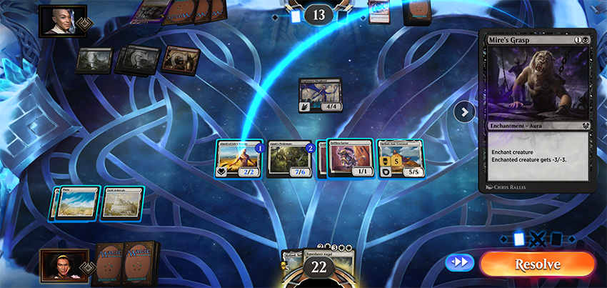
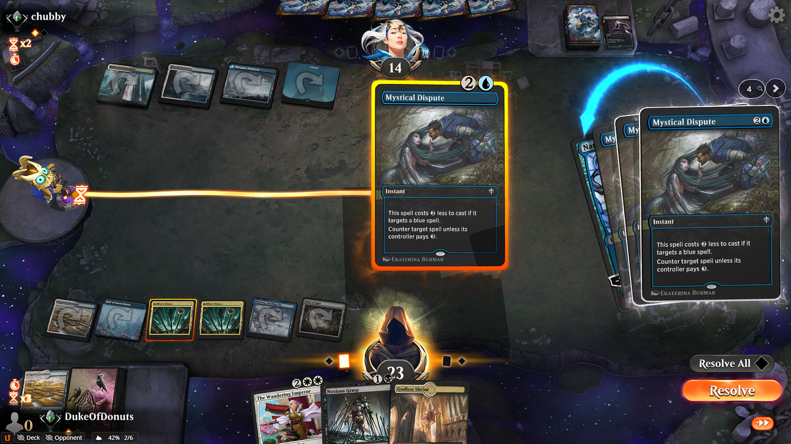
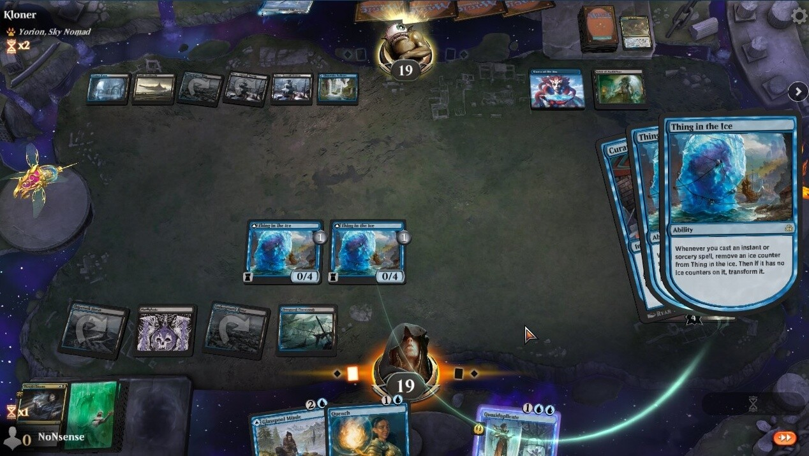
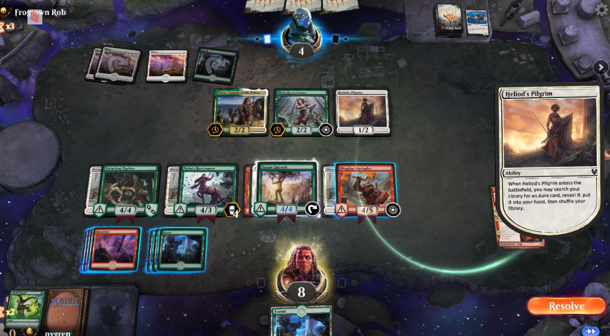

# Arena stack visual references

Saved 2026-11-15 for the Phone Play stack work. These are unmodified screenshots
downloaded from the URLs below, for design reference; they are not app assets.
Arena/card artwork belongs to Wizards of the Coast and the respective artists.

## Single spell on mobile (primary layout reference)

- [Official Wizards article: State of the Game – January 2021](https://magic.wizards.com/en/news/mtg-arena/mtg-arena-state-game-january-2021-01-21)
- [Original image](https://media.wizards.com/2020/images/daily/m7g4ren4_gameplay.png)
- Shows Mire's Grasp on the right, upright and substantially larger than battlefield
  cards. The circular collapse chevron sits to its left. Resolve is below it.

## Four spells / counterspell response (primary overlap reference)

- [Anthony Dolce's gameplay article, 2022-05-27](https://medium.com/new-frontiers/esper-control-is-the-truth-in-explorer-3257da9225f4)
- [Original image](https://miro.medium.com/v2/resize:fit:1400/1*BYPpLN7eggak23kQS9PDWA.png)
- The right-side stack has four items. The newest/rightmost card is upright;
  older cards fan left with increasing counterclockwise rotation. A small count
  with a magnifier and a circular chevron sit above. Resolve / Resolve All are
  below. The large highlighted card in the middle is a separate preview, **not**
  the stack's front card.

## Several triggered abilities (secondary fan reference)

- [Page where the screenshot was found](https://se7en.ws/godot-takticheskie-strategii-ot-radius-tactix/)
- [Original hosted image](https://habrastorage.org/getpro/habr/upload_files/9ba/3c3/553/9ba3c3553e39640f146b4d8182a9e29f.jpg)
- Shows an upright Thing in the Ice ability in front of other left-fanned cards.
  This is an ability frame, not a normal spell-card frame. Use the fan/placement
  as reference; don't replace normal cards with the ability-shaped frame.

## Single triggered ability on desktop (secondary placement reference)

- [Erik Nygren's gameplay article](https://medium.com/@_nygren/virtualized-magic-the-gathering-online-and-arena-or-how-to-get-your-cardboard-crack-when-all-fd208f3f29c6)
- [Original image](https://miro.medium.com/v2/1*7Ek5zXz7AMAncgQRjWtlhw.png)
- Right-side large ability frame, collapse chevron above, Resolve beneath.

## Implementation direction

Observations above come from these saved images, rather than a live Arena build.
Keep full card images for spells, show the newest item in front, fan a bounded
number of older items left, and keep the full stack reachable through the count
button. Hide all stack controls when empty. Collapse should expose the battlefield
without resolving anything. Retain manual resolution: Magic Board has no rules
engine or Arena priority/auto-pass system.

Relevant code: `PhoneStackCardsView` and `PhoneStackController` in
`Magic Board/PhonePlay/PhoneSessionControllers.swift`; stack placement and buttons
in `BoardViewController.layoutPhoneBattlefield()`.

## Magic Board implementation screenshots

These are **our implementation**, not online Arena references. Captured on the
iPhone SE 3 simulator (667 × 375 pt), 2026-11-15, after the spacing polish:

- [Four spells](Implementation/phone-four-spells.png)
- [Single spell](Implementation/phone-single-spell.png)
- [Collapsed](Implementation/phone-collapsed.png)
- [Direct board targeting](Implementation/phone-direct-targets.png)
- [Permanent entering tapped](Implementation/phone-enters-tapped.png)
- [Same permanent untapped](Implementation/phone-same-card-untapped.png)
- [Hand permanent landed](Implementation/phone-hand-permanent-landed.png)
- [Combat outline attached to rotating mini-card](Implementation/phone-combat-outline.png)
- [Combat assignment line](Implementation/phone-combat-lines.png)
- [Resolved permanent](Implementation/phone-resolved-permanent.png)
- [Stack slide / reopen video](Implementation/phone-stack-slide.mp4)
- [Permanent and spell resolution video](Implementation/phone-resolution.mp4)
- [Target arcs](Implementation/phone-target-arcs.png) — subsequent 2026-11-15
  follow-up: glowing curves to a creature, grouped land, player and another spell.
  The short spell-to-spell curve loops outside the fan. This fixture exercises
  arbitrary manual endpoints, not Memory Lapse's legal target restrictions.

`testArenaStackFansCollapsesAndResolves` passes, as does the existing
`testOriginalBoardPhoneHandAndStack` flow. The expanded fan may cover rightmost
battlefield cards, as Arena's does; collapsing reveals them without moving them.
This pass was visually checked on SE; Duo/larger-device comparison is still a
useful follow-up. See `Docs/PhonePlayHandoff.md` for implementation and test notes.

The official mobile screenshot above also provides the cyan targeting-curve
reference; the counterspell screenshot shows the broader spell-to-spell loop.
Target selection/editing and snapshot compatibility have focused checks in
`testSpellTargetPickerDrawsAndEditsArcs` and the three `PhoneGameTests` target tests.

The later interaction pass replaces automatic table presentation with direct
board targeting (Done / Cancel / List), retains card edges in the collapsed stack,
draws blocker assignment lines, and animates resolution. The collapsed screenshot
above reflects that newer behavior. Five focused UI checks pass on SE, plus the
extended Stop Blocking check; screenshots and recorded motion were reviewed.
